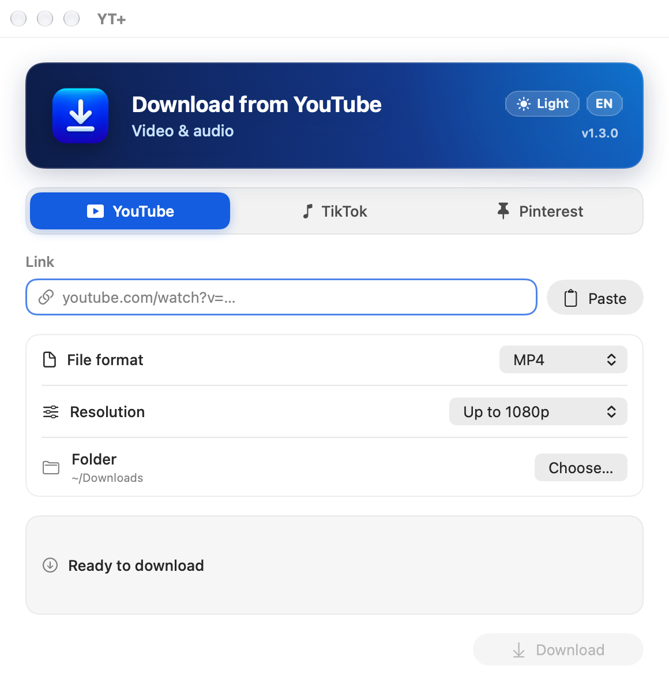
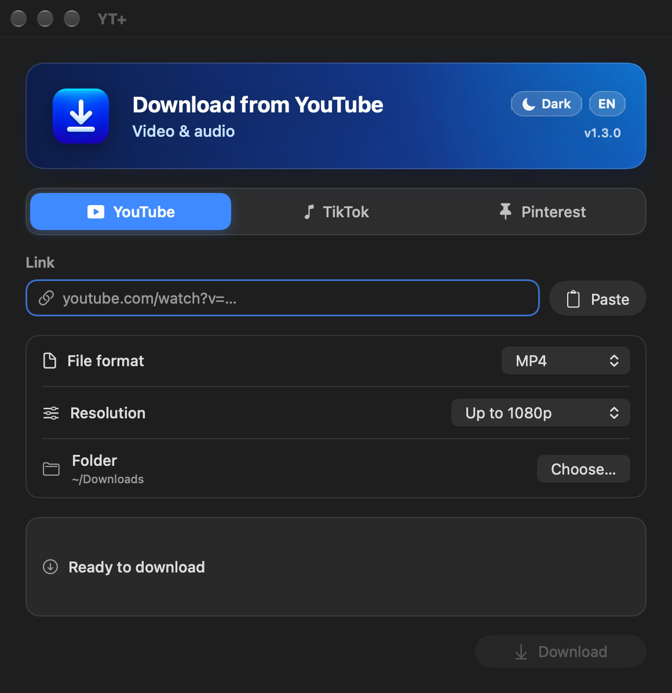

# YT+

A native desktop app for **macOS 14+ (Apple Silicon)** and **64-bit Windows 10/11** that downloads individual videos and audio from **YouTube**, **TikTok**, and **Pinterest** — plus original-quality photos and GIFs from Pinterest.

Supported video formats: **MP4, MKV, WebM, MOV, AVI** (144p up to 8K / Best available).  
Supported audio formats: **MP3, M4A, Opus, WAV, FLAC**.

<table>
  <tr>
    <td align="center"><b>Light</b></td>
    <td align="center"><b>Dark</b></td>
  </tr>
  <tr>
    <td></td>
    <td></td>
  </tr>
</table>

## Download

Grab the latest self-contained installer from the [Releases](https://github.com/mrsychqq/yt-plus-download/releases) page — **both macOS and Windows installers already bundle `yt-dlp`, `FFmpeg`, `FFprobe`, and `Node.js`**, so no extra setup is required:

- **macOS (Apple Silicon):** `YTPlus-1.3.0-macOS-arm64.dmg`
- **Windows (x64):** `YTPlus-1.3.0-Windows-x64-Setup.exe`

### First Launch (Security Prompts)

Because YT+ is a free, open-source app without paid Apple Developer or Windows Authenticode code-signing certificates, your operating system will show an "unidentified developer" warning the first time you open it. All source code and build scripts are public in this repository.

- **macOS (Gatekeeper):** After dragging **YT+** to **Applications**, right-click (or Control-click) **YT+** and choose **Open → Open**. On macOS Sequoia or later, if macOS blocks the launch, open **System Settings → Privacy & Security**, scroll down, and click **Open Anyway** (or run `xattr -cr "/Applications/YT+.app"` in Terminal).
- **Windows (SmartScreen):** When running `YTPlus-1.3.0-Windows-x64-Setup.exe`, click **More info** and then **Run anyway**.

## Installation & Usage

1. **Install:**
   - On **macOS**, open the DMG and drag **YT+** into **Applications**.
   - On **Windows**, run `YTPlus-1.3.0-Windows-x64-Setup.exe`. The installer lets you choose the installation directory and optionally creates Start Menu and Desktop shortcuts.
2. **Theme & Language:** Use the buttons in the top-right corner of the header to switch between **System / Light / Dark** themes and **EN / RU** interface languages. Your selection is saved automatically.
3. **Paste a Link:** Pick the **YouTube**, **TikTok**, or **Pinterest** tab and paste a video or pin link (the platform switches automatically when you paste a link). Supports standard YouTube URLs, Shorts, and `youtu.be`; TikTok links (`tiktok.com`, `vm.tiktok.com`, `vt.tiktok.com`); and Pinterest video or photo pins (`pinterest.*`, `pin.it`). When a Pinterest pin contains an image, the original (`JPG`, `PNG`, `WebP`, or `GIF`) is downloaded automatically.
4. **Choose Format & Folder:** Select a format, resolution cap (for video), and output folder. Defaults to MP4, up to 1080p, and your Downloads folder.
5. **Download:** Click **Download**. Once finished, click **Show in Finder** (macOS) or **Show in Folder** (Windows) to reveal the file.

### Features

- **All-in-one installers:** Both macOS and Windows packages ship with `yt-dlp`, `FFmpeg`, `FFprobe`, and `Node.js` bundled inside — works immediately after install.
- **Resolution limits:** 144p, 240p, 360p, 480p, 720p, 1080p, 1440p, 2160p (4K), 4320p (8K), and **Best available**, handled properly for both horizontal and vertical videos (Shorts, TikTok, Pinterest).
- **Auto-resume on connection loss:** Downloads up to four concurrent fragments for DASH and HLS streams. If your internet connection drops, YT+ keeps partial files, waits for connectivity to return, and automatically resumes from where it left off.
- **Lossless audio preference:** For M4A and Opus, prefers matching source audio streams to avoid unnecessary re-encoding whenever possible.

## Building from Source

### macOS

Requires Xcode Command Line Tools. For local development builds without bundling tools (uses locally installed `yt-dlp`, `ffmpeg`, and `deno`/`node`):

```sh
bash scripts/build.sh
open "dist/YT+.app"
```

To build a self-contained DMG with all tools bundled inside `YT+.app/Contents/Resources/tools/`:

```sh
bash scripts/package.sh
```

### Windows (cross-built on macOS)

Requires .NET 10 SDK, NSIS (`makensis`), and 7-Zip (`7zz`):

```sh
bash scripts/package-windows.sh
```

The script verifies SHA-256 checksums for bundled tools and packages them together with the Windows x64 application, .NET runtime, and third-party license files. Shared formats, resolutions, and `yt-dlp` options live in `Resources/DownloadProfiles.json`.

## License

[MIT](LICENSE)
